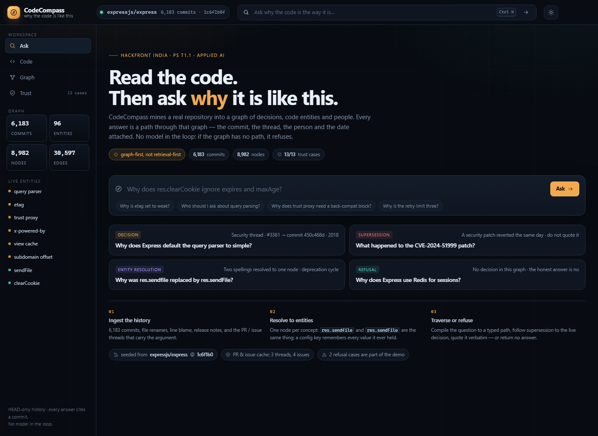

# CodeCompass

**Why the code is like this.** A graph-native answer engine over a real repository's history — every answer carries the commit, the thread, the person and the date, or it refuses.

hackFront India 2026 · Theme **T1 — AI & Developer Tools** · Problem statement **T1.1 "Why The Code Is Like This"** (Applied AI).



---

## The problem, in one line

A new engineer can read code; they cannot read intent. The reasoning behind a line lives in a commit message, a closed PR, an incident thread and one senior engineer's head — and it walks out of the door with them. Documentation drifts; vector search returns text that *mentions* a topic, not the decision that governs it; and a decision reversed two years ago still sits in the archive looking authoritative.

CodeCompass answers **"why is this the way it is?"** with a chain of evidence, detects when a later decision quietly overrode an earlier one, and refuses when the graph has no path.

## What is actually running

| | |
|---|---|
| Repository | [`expressjs/express`](https://github.com/expressjs/express) — **6,183 commits** reachable from HEAD `1c6f1b0`, 2009 → 2026 |
| Graph | **8,982 nodes / 30,597 typed edges** — commits, files, config keys, API members, people, PRs, issues, comments, docs, code markers |
| Graph store | Embedded property graph for the offline demo; the **same model exports to Neo4j AuraDB** with one command (`npm run export:cypher`) |
| Retrieval | Entity linking → typed traversal → supersession resolution → extractive evidence chain. **No LLM in the loop**, no API keys |
| Trust harness | **13/13** fixed cases, including **two that must refuse** |
| Engine tests | **30/30** (`npm test`) |

The demo is deterministic and offline: no model call, no network, no key.

## Four questions it is built to answer

1. **Why does Express default the query parser to `simple`?**
   → commit `450c468d` (Czarek, 15 Apr 2018), raised in **issue #3361** because the extended parser let a payload bypass the IE/Edge XSS filter. The engine quotes the thread, names Douglas Christopher Wilson as the person to ask, and marks the 2014 default (`extended`) as superseded.
2. **Why does `res.clearCookie()` ignore `expires` and `maxAge`?**
   → the 2015 signature is not the answer. Function-span blame finds the **2024** body change `82fc12a4` (Jon Church, PR #5792), whose stated reason is that a `maxAge` would otherwise make a deleted cookie survive into the future.
3. **What happened to the CVE-2024-51999 patch?**
   → the security patch `2f64f68c` was **reverted the same day** by `697547cd`. Release notes say the CVE was rejected and the change "fully reverted". The answer leads with the reversal instead of quoting a dead decision.
4. **Why does Express use Redis for sessions?**
   → **refused.** Redis appears in dependency commits and examples, but no decision node governs Express itself. The engine says what is missing instead of returning the nearest neighbour.

## How an answer is built

```text
question
   │
   ├─ 1. link        anchors (config keys, API members, files, people, #PR, CVE ids)
   │                 morphology: "query parsing" → "query parser"
   │                 entity resolution: res.sendfile ≡ res.sendFile (one node, two spellings)
   │
   ├─ 2. traverse    CHANGED / MENTIONS / OWNS / AUTHORED_BY / IN_PR / REFERENCES
   │                 + function-span git blame for body-level changes
   │
   ├─ 3. resolve     REVERTS and SUPERSEDES edges decide what is live
   │                 retired spellings get a rename warning, not stale advice
   │
   ├─ 4. quote       verbatim sentences from commit bodies, PR/issue threads, release notes
   │                 ranked for reason markers (because / avoid / security / regression)
   │
   └─ 5. score       coverage + evidence richness + supersession state
                     below threshold → refuse, with a list of what is missing
```

The answer composition is **extractive**: every sentence is a graph fact or a quote with an author, date and URL. Nothing is paraphrased into existence.

### Graph schema (the part that matters)

| Node | Examples | Why it exists |
|---|---|---|
| `commit` | `450c468d`, `82fc12a4` | a decision record; carries body, author, date, files |
| `config` / `api` | `query parser`, `etag`, `clearCookie` | the entity that accumulates decisions over time |
| `person` | 414 identities (emails + GitHub handles) | "who to ask", weighted by authorship, discussion and ownership |
| `pr` / `issue` / `comment` | #3361, #3621, #5792 | the discussion that produced the decision |
| `doc` | 1,312 release-note lines | what documentation claims — often the *what*, rarely the *why* |
| `file` / `marker` | `lib/response.js`, back-compat comments | code surface and the flags nobody understands |

Edges: `CHANGED`, `MENTIONS`, `TOUCHED`, `AUTHORED_BY`, `OWNS`, `REVERTS`, `SUPERSEDES`, `IN_PR`, `REFERENCES`, `HAS_COMMENT`, `DOCUMENTS`, `DECLARED_IN`, `RENAMED_FROM`, `CO_CHANGED`.

### Supersession is a first-class edge

- **Revert** → parse `Revert "…"` / `This reverts commit <sha>` → `REVERTS` edge; the original is marked dead and never leads an answer.
- **Value change** → a config key whose later value differs from the earlier default → `SUPERSEDES`.
- **Removal / rename** → `res.sendfile` retired in `0fc4f07` (Nov 2014) after `8449f23` deprecated it; both spellings resolve to one entity, and the old name returns a supersession warning.

## Run it

Requirements: **Node 20+** (built on Node 24), no API keys, no database.

```bash
cd src/api
npm install
npm test          # 30 engine + trust assertions
npm start         # http://localhost:8787  (serves the built UI + API)
```

The UI is already built in `src/web/dist`. To work on the frontend:

```bash
cd src/web
npm install
npm run dev       # http://localhost:5173, proxies /api to :8787
```

Deep links useful for a demo: `/?q=…`, `/?view=code`, `/?view=graph`, `/?view=trust`, `/?theme=light`.

### Re-ingest, or point it at another repository

```bash
git clone --quiet https://github.com/expressjs/express.git .repos/express
cd src/api && npm run ingest        # graph + blame + docs → src/data/express.graph.json
```

`ingest.js` is generic over a git checkout: it reads the default branch's reachable history, source files under `lib/`, `History.md` / `Readme.md`, and the optional GitHub cache. `tools/fetch_github.js` refreshes PR/issue threads (unauthenticated API, 60 req/h; results are cached so the demo stays offline).

### Neo4j AuraDB path

```bash
npm run export:cypher
# → deploy/neo4j/{nodes.csv,rels.csv,import.cypher,queries.cypher}
```

Import in AuraDB with APOC core enabled. The import is idempotent and creates one label per node type plus a `Node` constraint on `id`. See [`deploy/README.md`](deploy/README.md).

## Trust, stated up front

`/api/eval` runs the 13 fixed cases on every request; the **Trust** tab renders the same data. It includes the two refusal cases and lets them fail visibly.

| Case | Expected |
|---|---|
| query parser default | commit `450c468d` + XSS rationale + high confidence |
| clearCookie ignore | `82fc12a4` via function-span blame |
| CVE-2024-51999 | leads with reversal, quotes "CVE rejected" |
| sendfile → sendFile | one entity, retired spelling flagged |
| who / query parsing | Douglas Christopher Wilson (authorship + thread + ownership) |
| who / clearCookie | Jon Church |
| Redis sessions | refusal |
| retry limit three | refusal |
| etag weak | `c21226aa`, low-confidence label rather than invention |
| trust proxy back-compat | `b40e74d6`, comment-level evidence |
| line 715 / 97 | line author separated from governing decision |
| commit lookup | `82fc12a4` + matching release note |

**Known limits** (also shown in the UI): HEAD-only history excludes unmerged branches; the PR/issue cache is curated; retrieval is graph + IDF, not embeddings; anchor extraction is JS-oriented; confidence is a documented heuristic, not a calibrated probability.

## Why this is not a search box

- A keyword match alone **cannot** produce an answer: the guard requires an entity, a cited thread, a CVE id, a file or a near-verbatim commit subject. "Why does Express use Redis for sessions?" matches the word *redis* in dependency commits — and is still refused.
- A reversed decision **cannot** become the current truth: the revert edge is checked before composition.
- A body-level change **cannot** hide behind an old signature: blame over the function span finds the commit that owns the behaviour, not just the text.
- The graph, not a model, decides which evidence exists. The Trust view shows the checks.

## Repository map

```
src/api/
  ingest.js        git → typed graph (metadata, patches, blame, docs, GitHub cache)
  reasoner.js      entity linking, traversal, supersession, confidence, refusal
  eval.js          13-case trust harness
  server.js        API + static host
  test.js          30 assertions over the real graph
src/data/
  express.graph.json   the ingested graph (7 MB)
  github.json          cached PR / issue threads
src/web/           React + Vite UI (Ask / Code / Graph / Trust)
tools/
  fetch_github.js  refresh the discussion cache
  export_cypher.js Neo4j AuraDB export
deploy/neo4j/      CSVs + import + example traversals
docs/              deck, screenshots, submission notes, demo script
```

## Submission assets

- `docs/CodeCompass-hackFront-India.pptx` — presentation (problem, mechanism, demo evidence, limits)
- `docs/screenshots/` — the four screens at 1440 px
- `docs/DEMO.md` — 90-second demo script with exact questions and fallbacks
- `docs/ORGANIZER-NOTES.md` — setup, what is complete, what is deliberately out of scope
- `CodeCompass-source.zip` — complete source, no `node_modules`, no clone

GitHub repository link: **to be added by the team** after the first push. The code is self-contained; `.gitignore` excludes the clone, dependencies, the internal research folder and the archive.

## Team

Built for hackFront India 2026. Team details go in the submission form; this repository is the technical record.
